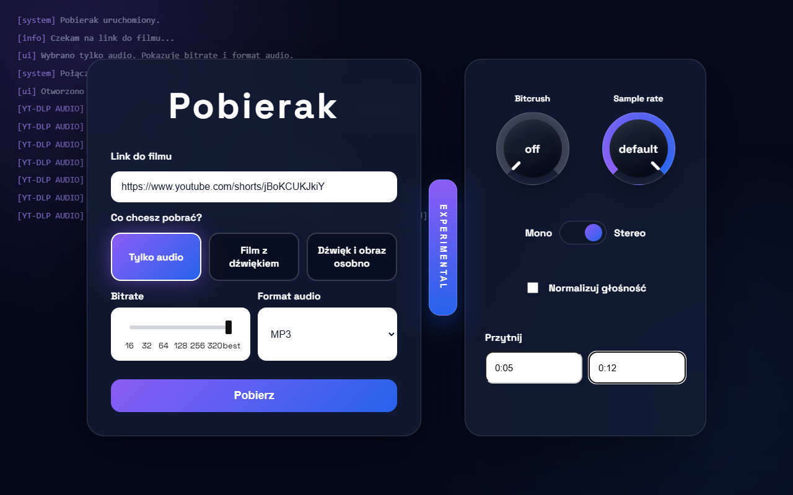

# Pobierak

Pobierak to mała strona działająca na twoim komputerze, która pobiera filmy i dźwięk z YouTube i innych serwisów obsługiwanych przez [yt-dlp](https://github.com/yt-dlp/yt-dlp). Wklejasz link, wybierasz, co chcesz dostać, klikasz „Pobierz” i plik trafia do folderu pobierania przeglądarki.



Co potrafi:

- **Tylko audio** — MP3, WAV, M4A albo FLAC, z wyborem bitrate (16–320 kb/s albo najlepszy dostępny).
- **Film z dźwiękiem** — MP4, MPEG, MJPEG (plik `.avi`) albo MKV, z wyborem rozdzielczości (144p–1080p albo najlepsza dostępna).
- **Dźwięk i obraz osobno** — dwa pliki: sam obraz i sam dźwięk.
- **Panel EXPERIMENTAL** — przycinanie i efekty dźwięku (opis [niżej](#panel-experimental)).

Program działa tylko na twoim komputerze. Nic nie wysyła na zewnątrz poza samym pobraniem filmu.

## Wymagania

| Program | Do czego służy |
|---|---|
| [Node.js](https://nodejs.org) 18 lub nowszy | uruchamia program |
| [yt-dlp](https://github.com/yt-dlp/yt-dlp) | pobiera filmy |
| [ffmpeg](https://ffmpeg.org) | łączy obraz z dźwiękiem, zmienia format, przycina, nakłada efekty |
| [Deno](https://deno.com) | yt-dlp potrzebuje go do pełnej obsługi YouTube |

Na Windowsie i macOS skrypt startowy sam sprawdzi, czego brakuje, i zapyta, czy to zainstalować.

## Instalacja

### Windows

1. Na stronie repozytorium kliknij **Code → Download ZIP** (albo wpisz `git clone https://github.com/agawa98/Pobierak.git`).
2. Rozpakuj ZIP w dowolnym folderze.
3. Kliknij dwa razy **`start.bat`**.
4. Jeśli brakuje któregoś z wymaganych programów, skrypt wypisze, których, i zapyta `Zainstalowac? [T/N]`. Naciśnij `T` — programy zainstaluje `winget` (jest częścią Windows 11 i aktualnego Windows 10).
5. Po instalacji zamknij okno i kliknij **`start.bat`** jeszcze raz. Nowe programy są widoczne dopiero w nowym oknie.
6. Strona otworzy się w przeglądarce pod adresem `http://localhost:3000`. Okna z programem nie zamykaj — zamknięcie go wyłącza Pobieraka.

Przy pierwszym uruchomieniu skrypt pobiera też zależności programu (`npm install`); potrzebny jest do tego internet.

**Instalacja ręczna** (jeśli nie chcesz, żeby skrypt cokolwiek instalował) — w oknie PowerShell albo wiersza polecenia:

```
winget install --id OpenJS.NodeJS.LTS -e
winget install --id yt-dlp.yt-dlp -e
winget install --id yt-dlp.FFmpeg -e
winget install --id DenoLand.Deno -e
```

Pakiet `yt-dlp.yt-dlp` sam doinstalowuje ffmpeg i Deno, więc dwie ostatnie komendy zwykle nie mają już nic do zrobienia. Potem otwórz nowe okno, przejdź do folderu programu i wpisz:

```
npm install
npm start
```

### macOS

1. Potrzebny jest [Homebrew](https://brew.sh). Jeśli go nie masz, wklej w Terminalu komendę z jego strony:

   ```
   /bin/bash -c "$(curl -fsSL https://raw.githubusercontent.com/Homebrew/install/HEAD/install.sh)"
   ```

2. Na stronie repozytorium kliknij **Code → Download ZIP** i rozpakuj plik (albo `git clone https://github.com/agawa98/Pobierak.git`).
3. Kliknij dwa razy **`start.command`**.
4. Jeśli brakuje któregoś z wymaganych programów, skrypt zapyta `Zainstalowac? [T/N]`. Wpisz `T` i naciśnij Enter — programy zainstaluje `brew`, a Pobierak uruchomi się od razu, bez ponownego klikania.
5. Strona otworzy się w przeglądarce pod adresem `http://localhost:3000`. Okna Terminala nie zamykaj.

**Gdy macOS zablokuje `start.command`.** Plik pobrany w ZIP-ie bywa przy pierwszym dwukliku blokowany (komunikat, że nie można go otworzyć albo że pochodzi od niezidentyfikowanego dewelopera). Wtedy kliknij go prawym przyciskiem i wybierz **Otwórz** (w nowszych wersjach macOS: Ustawienia systemowe → Prywatność i ochrona → **Otwórz mimo to**), albo otwórz Terminal w folderze programu i wpisz:

```
sh start.command
```

**Instalacja ręczna:**

```
brew install node yt-dlp ffmpeg deno
npm install
npm start
```

Dwie ostatnie komendy wpisz w folderze programu.

### Linux

**Na Linuksie program nie był uruchamiany ani razu** — autor nie ma takiej maszyny. Kod jest ten sam co na Windowsie i macOS, ale komendy poniżej nie zostały sprawdzone. Zgłoszenia błędów są mile widziane.

Skrypt `start.sh` niczego nie instaluje. Jeśli czegoś brakuje, wypisze listę i zakończy pracę.

1. Zainstaluj Node.js i ffmpeg menedżerem pakietów swojej dystrybucji:

   ```
   sudo apt install nodejs npm ffmpeg        # Debian, Ubuntu
   sudo dnf install nodejs npm ffmpeg        # Fedora
   sudo pacman -S nodejs npm ffmpeg deno     # Arch
   ```

   Na Fedorze pakiet `ffmpeg` może wymagać włączenia repozytorium RPM Fusion.

2. Zainstaluj Deno (na Archu jest już w komendzie wyżej):

   ```
   curl -fsSL https://deno.land/install.sh | sh
   ```

3. Zainstaluj yt-dlp z oficjalnego pliku albo przez `pipx`. Wersje z repozytoriów dystrybucji bywają za stare i przestają działać z YouTube.

   ```
   sudo curl -L https://github.com/yt-dlp/yt-dlp/releases/latest/download/yt-dlp -o /usr/local/bin/yt-dlp
   sudo chmod a+rx /usr/local/bin/yt-dlp
   ```

   albo:

   ```
   pipx install yt-dlp
   ```

4. Pobierz program (`git clone https://github.com/agawa98/Pobierak.git` albo ZIP), przejdź do jego folderu i wpisz:

   ```
   ./start.sh
   ```

   Jeśli plik pochodzi z ZIP-a i system odmawia uruchomienia, wpisz `sh start.sh`.

Dwuklik w `start.sh` zależy od menedżera plików (część otwiera wtedy plik w edytorze), więc pewnym sposobem jest `./start.sh` w terminalu.

**Instalacja ręczna** to kroki 1–3, a potem w folderze programu:

```
npm install
npm start
```

## Uruchamianie

| System | Dwuklik | W terminalu |
|---|---|---|
| Windows | `start.bat` | `start.bat` |
| macOS | `start.command` | `sh start.command` |
| Linux | zależy od menedżera plików | `./start.sh` |

Sposób działający na każdym systemie (w folderze programu):

```
npm start
```

`npm start` nie otwiera przeglądarki — wejdź sam na `http://localhost:3000`. Program zatrzymuje się skrótem `Ctrl+C` albo zamknięciem okna.

Przy starcie program wypisuje adres strony oraz wersje yt-dlp i ffmpeg. Jeśli któregoś nie znajdzie, napisze, którego brakuje i jak go zainstalować; strona się wtedy otworzy, ale pobieranie nie zadziała.

## Na czym sprawdzono

| System | Stan |
|---|---|
| Windows 11 Home (kompilacja 26200) | Pobieranie sprawdzone ręcznie we wszystkich trybach; testy automatyczne przechodzą. Node 24.16.0, yt-dlp 2026.03.17, Deno 2.8.0. |
| macOS | Niesprawdzony. Program nie był jeszcze uruchamiany na Macu. |
| Linux | Niesprawdzony. Program nie był uruchamiany ani razu. |

W repozytorium jest zestaw testów automatycznych (`npm test`) przygotowany do uruchamiania na GitHubie na Windowsie, macOS i Linuksie. Do tej pory testy były uruchamiane tylko na Windowsie.

## Gdy YouTube przestaje działać

YouTube często coś zmienia i stare wersje yt-dlp przestają wtedy pobierać. Jeśli pobieranie nagle kończy się błędem, najpierw zaktualizuj yt-dlp:

| Jak był instalowany | Komenda |
|---|---|
| winget (Windows) | `winget upgrade --id yt-dlp.yt-dlp -e` |
| Homebrew (macOS) | `brew upgrade yt-dlp` |
| oficjalny plik | `yt-dlp -U` |
| pipx | `pipx upgrade yt-dlp` |

Potem uruchom Pobieraka jeszcze raz. Przyczyna błędu jest wypisana pod przyciskiem „Pobierz” oraz w oknie z programem.

## Ustawienia

Program czyta cztery zmienne środowiskowe. Żadna nie jest wymagana.

| Zmienna | Domyślnie | Znaczenie |
|---|---|---|
| `PORT` | `3000` | Port strony. Zmień, gdy program pisze, że port jest zajęty. Skrypty startowe otwierają przeglądarkę na tym porcie. |
| `HOST` | `127.0.0.1` | Adres, na którym program nasłuchuje. Domyślnie strona jest dostępna tylko z tego komputera. `0.0.0.0` udostępnia ją innym urządzeniom w sieci domowej — program nie ma hasła, więc nie rób tego w sieci, której nie ufasz. |
| `YTDLP_PATH` | — | Pełna ścieżka do pliku yt-dlp, jeśli chcesz użyć konkretnego egzemplarza. |
| `FFMPEG_PATH` | — | Pełna ścieżka do pliku ffmpeg. |

Przykład — start na porcie 3001:

```
set PORT=3001
npm start
```

(wiersz polecenia Windows)

```
$env:PORT = "3001"
npm start
```

(PowerShell)

```
PORT=3001 npm start
```

(macOS i Linux)

### Folder `bin`

Zamiast instalować yt-dlp i ffmpeg w systemie, możesz utworzyć w folderze programu folder `bin` i wrzucić do niego pliki `yt-dlp.exe` i `ffmpeg.exe` (Windows) albo `yt-dlp` i `ffmpeg` (macOS, Linux). Obok ffmpeg połóż też `ffprobe` z tej samej paczki.

Program szuka każdego z tych dwóch programów po kolei: zmienna środowiskowa → folder `bin` → programy zainstalowane w systemie (PATH). Node.js i Deno muszą być zainstalowane w systemie.

## Panel EXPERIMENTAL

Panel otwiera się przyciskiem **EXPERIMENTAL** z boku karty. Wszystkie ustawienia dotyczą bieżącego pobrania.

| Ustawienie | Co robi |
|---|---|
| **Bitcrush** | Celowo psuje dźwięk — im dalej przekręcone pokrętło (1–15), tym mocniejszy efekt. `off` wyłącza. |
| **Sample rate** | Częstotliwość próbkowania dźwięku od 8000 do 48000 Hz. `default` zostawia oryginalną. |
| **Mono / Stereo** | Mono łączy oba kanały w jeden. |
| **Normalizuj głośność** | Wyrównuje głośność nagrania. |
| **Przytnij** | Pobiera tylko fragment. Czas wpisujesz jako sekundy (`90`), `MM:SS` (`1:30`) albo `GG:MM:SS` (`1:02:03`). Można podać sam początek albo sam koniec. |

Efekty dźwięku działają w trybach „Tylko audio” i „Film z dźwiękiem” oraz na pliku dźwiękowym w trybie „Dźwięk i obraz osobno”. Przycinanie działa we wszystkich trybach.

Pobranie z efektami albo przycięciem trwa dłużej, bo po pobraniu plik jest przetwarzany przez ffmpeg. Przy przycinaniu program pobiera cały film i dopiero potem wycina fragment, a obraz jest kodowany od nowa.

## Pobrane pliki

Pliki trafiają najpierw do folderu `downloads` w folderze programu, a stamtąd przeglądarka zapisuje je w swoim folderze pobierania. **Pliki w `downloads` są usuwane po 30 minutach** (program sprząta przy starcie i potem co 10 minut). Link pod przyciskiem „Pobierz” przestaje wtedy działać, więc jeśli przeglądarka nie zapisała pliku sama, kliknij go od razu.

## Testy

```
npm test
```

Testy nie pobierają niczego z internetu. Część z nich używa ffmpeg; gdy go nie ma, są pomijane. Osobny zestaw `npm run test:przegladarka` sprawdza stronę w przeglądarce i wymaga zainstalowanego Edge.

## Licencja

[MIT](LICENSE) © 2026 agawa98

Font Space Grotesk w `public/fonts/` jest na licencji [SIL Open Font License](public/fonts/OFL.txt).
